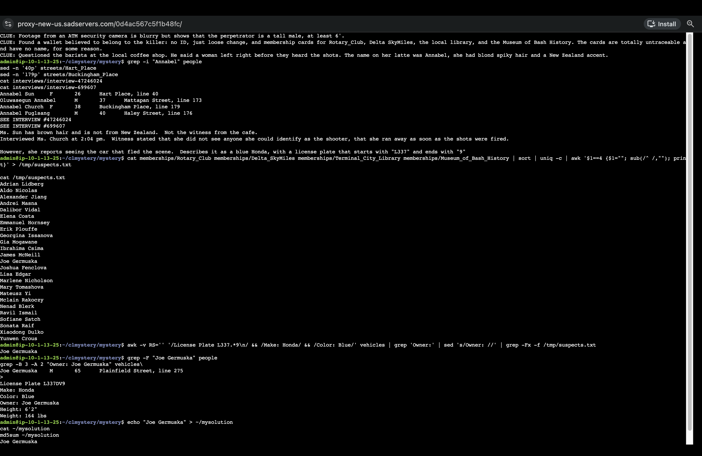

# Task 15: SadServers - Command Line Murders

## Objective

To develop Linux command-line troubleshooting skills by solving the Command Line Murders scenario on SadServers.

## Approach

1. Extracted relevant clues from the crime scene using grep.
2. Identified potential witnesses from the people database.
3. Retrieved witness interviews using sed and cat.
4. Cross-referenced four membership databases using sort, uniq and awk.
5. Filtered vehicle records based on the witness description.
6. Identified Joe Germuska as the murderer.
7. Submitted and successfully verified the solution on SadServers.

## Commands Learned

- grep - Searching and filtering text
- sed - Extracting specific lines
- awk - Processing and filtering records
- sort - Sorting text
- uniq - Identifying repeated entries
- cat - Reading and combining files
- md5sum - Generating checksums
- Pipes and output redirection

## Screenshots

### Investigation

### Successful Completion

## Outcome

Successfully completed the Command Line Murders challenge and gained practical experience in Linux command-line operations, pattern matching and data analysis.

## Resource

[Command Line Murders - SadServers](https://sadservers.com/scenario/command-line-murders)
