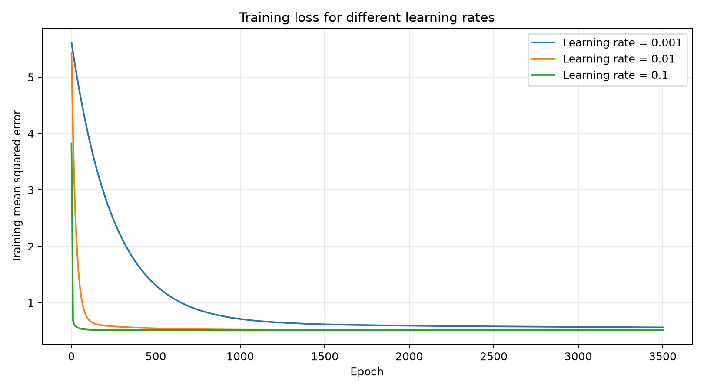
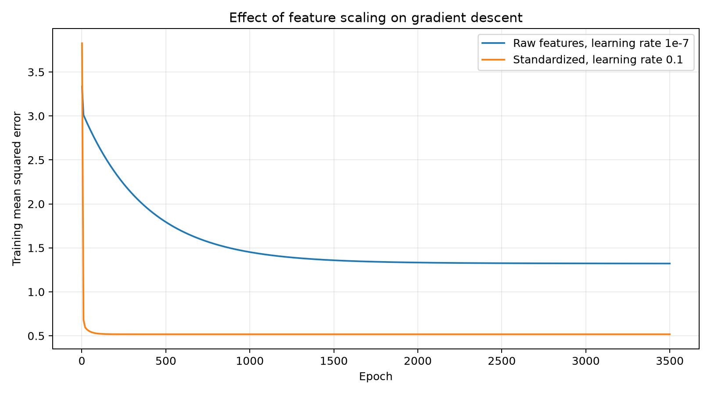
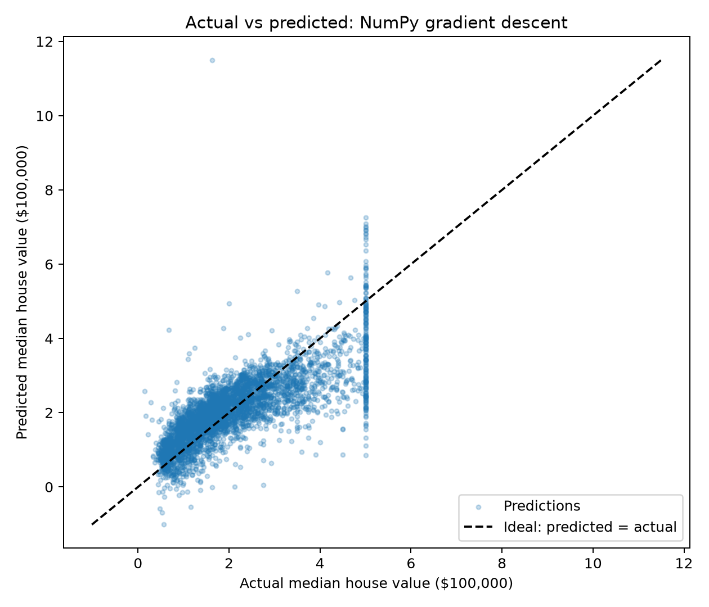

# MARVEL Task 6: Linear Regression from Scratch

## Objective
Implement full-batch gradient descent using NumPy; examine learning rates and scaling; compare with scikit-learn on the same held-out test set.

## Dataset
- California Housing: 20640 samples, 8 features.
- Train: 16512; test: 4128; random_state=42.
- Median house value is measured in $100,000 units.
- StandardScaler was fit on training features only, then applied to test features.

## Gradient descent (written with NumPy)
- Prediction: y_hat = X @ w + b
- MSE: mean((y_hat - y)**2)
- Weight gradient: (2/n) * X.T @ (y_hat - y)
- Bias gradient: 2 * mean(y_hat - y)
- Update: w = w - learning_rate * gradient; likewise for b.

## Learning-rate experiment (3500 epochs, standardized features)
| Learning rate | Test MSE | Test MAE | Test R² |
| --- | ---: | ---: | ---: |
| 0.001 | 0.58088 | 0.55723 | 0.55672 |
| 0.01 | 0.55620 | 0.53305 | 0.57555 |
| 0.1 | 0.55589 | 0.53320 | 0.57579 |

## Model comparison
| Model | Test MSE | Test MAE | Test R² |
| --- | ---: | ---: | ---: |
| NumPy gradient descent, scaled, lr=0.1 | 0.55589 | 0.53320 | 0.57579 |
| scikit-learn LinearRegression, scaled | 0.55589 | 0.53320 | 0.57579 |
| NumPy gradient descent, raw, lr=1e-7 | 1.29523 | 0.89753 | 0.01158 |

## Observations
- With standardized features, larger tested learning rates generally converge more quickly, provided they remain stable.
- Raw features require a much smaller learning rate because feature magnitudes differ.
- scikit-learn LinearRegression uses a direct least-squares solver rather than this manually implemented gradient descent loop.
- A lower MSE/MAE and higher R² mean better predictions on the same test set.
- A linear model can still miss nonlinear patterns in housing prices.

## Saved charts

## My explanation for the presentation
> Replace this with your own words after reviewing the code and graphs.
